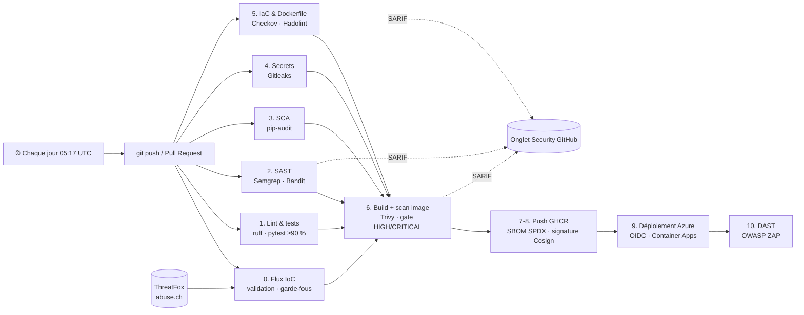

# 🛡️ SecureShip — Pipeline DevSecOps sur Azure


**SecureShip** est une API de Threat Intelligence (*IoC Checker*) livrée par une chaîne CI/CD **DevSecOps** complète :
chaque `git push` déclenche des contrôles de sécurité automatiques, et **aucune image vulnérable ne peut être déployée** sur Azure.

> Objectif du projet : appliquer le principe du *shift-left security* — détecter les failles le plus tôt possible,
> dans le code, les dépendances, les secrets, l'image Docker, l'infrastructure et l'application déployée.

---

## 🏗️ Architecture



| Étape | Outil | Ce qui est vérifié | Bloquant |
|---|---|---|---|
| 0 | ThreatFox + script Python | Flux IoC réel, chaque indicateur re-validé ; échec si flux vide ou effondré | ✅ |
| 1 | ruff, pytest | Qualité du code, 48 tests, couverture ≥ 90 % | ✅ |
| 2 | Semgrep, Bandit | Failles dans le code source (OWASP Top 10) | ✅ |
| 3 | pip-audit | Dépendances Python vulnérables (CVE) | ✅ |
| 4 | Gitleaks | Secrets commités dans tout l'historique Git | ✅ |
| 5 | Hadolint, Checkov | Bonnes pratiques Dockerfile et Terraform | Dockerfile ✅ |
| 6 | Trivy | CVE HIGH/CRITICAL de l'image (OS + librairies) | ✅ |
| 7-8 | Syft, Cosign | SBOM SPDX + signature *keyless* Sigstore | — |
| 9 | Azure CLI | Déploiement par **digest** de l'image signée + smoke test | ✅ |
| 10 | OWASP ZAP | Scan dynamique de l'API en production (OpenAPI) | ✅ |

## 🔄 Threat Intelligence mise à jour automatiquement

La pipeline tourne aussi **chaque jour** (`schedule`). Elle télécharge les IoC des 7 derniers jours depuis
**ThreatFox (abuse.ch)** avec `scripts/update_iocs.py`, puis reconstruit, re-scanne et redéploie l'image.
Résultat : la base de l'API est fraîche, et l'image est re-vérifiée contre les CVE publiées dans la nuit.

Le flux est traité comme une **donnée non fiable** :
- chaque IP, domaine et hash est re-validé avec les mêmes fonctions que l'API ;
- IP privées/réservées et domaines légitimes (`scripts/allowlist.txt`) écartés pour limiter les faux positifs ;
- URL ignorées (souvent hébergées sur des services légitimes) ;
- **garde-fous** : la mise à jour échoue si le flux est vide, démesuré, ou s'effondre de plus de 80 % — on ne publie jamais une base vide ;
- la clé d'API est un **secret GitHub** (`ABUSECH_AUTH_KEY`), jamais dans le code ; chaque flux est archivé 30 jours (artefact).

`GET /api/v1/stats` indique la source et la date de génération du flux embarqué.

## 🔐 Choix de sécurité

- **Zéro secret cloud stocké** : GitHub Actions s'authentifie auprès d'Azure par **OIDC** (fédération d'identité), via une identité managée limitée au seul *resource group* du projet et au seul environnement GitHub `production`.
- **Moindre privilège** : `permissions: contents: read` par défaut ; chaque job demande uniquement les droits nécessaires.
- **Conteneur durci** : build multi-étapes, image *slim*, mises à jour de sécurité, exécution en **utilisateur non-root** (UID 10001), `HEALTHCHECK`, en-tête `Server` supprimé.
- **Supply chain** : SBOM, signature et attestation Cosign, déploiement par digest (immuable), Dependabot pour les dépendances, l'image de base, les actions GitHub et Terraform.
  Toutes les actions GitHub sont **épinglées par SHA de commit** (immuable) : des tags de `trivy-action` ont été réécrits avec du code malveillant en 2026 (CVE-2026-33634). Dependabot applique un délai de 7 jours avant de proposer une nouvelle version.
- **Application** : validation stricte des entrées (IP, domaine, hash), taille maximale, messages d'erreur sans réflexion de l'entrée (anti-XSS), en-têtes OWASP (CSP, HSTS, X-Frame-Options…).
- **Infrastructure as Code** : Terraform, HTTPS forcé, mise à l'échelle à zéro, quota de logs et **alerte budget** pour maîtriser les coûts.

## 🌐 Interface web

La page d'accueil (`/`) s'adresse à tout le monde, pas seulement aux experts :
- un champ unique : lien, domaine, IP (avec port) ou empreinte de fichier, **type détecté automatiquement** ;
- liens « désarmés » acceptés (`hxxps://site[.]com`), jusqu'à **100 éléments** à la fois ;
- verdict clair (Signalé / Rien trouvé / Non reconnu), menace, niveau de confiance et **conseil adapté** ;
- explications, méthode pour obtenir l'empreinte d'un fichier, foire aux questions ;
- **français / anglais**, mode sombre, utilisable au clavier et sur mobile.

Côté sécurité : CSP stricte sans script inline, polices auto-hébergées (aucun pistage tiers),
affichage en `textContent` contre le XSS, aucune recherche enregistrée.

## 🚀 API

| Endpoint | Exemple | Réponse |
|---|---|---|
| `GET /api/v1/check?q=` | `/api/v1/check?q=hxxp://evil[.]example` | type détecté automatiquement (IP, IP:port, URL, domaine, hash) |
| `POST /api/v1/check/bulk` | `{"indicators": ["192.0.2.10", "utt.fr"]}` | jusqu'à 100 indicateurs |
| `GET /health` | `/health` | état et version déployée |
| `GET /api/v1/check/ip/{ip}` | `/api/v1/check/ip/192.0.2.10` | IPv4/IPv6 connue ? privée ? |
| `GET /api/v1/check/domain/{domain}` | `/api/v1/check/domain/login.malicious.example` | détecte aussi les sous-domaines |
| `GET /api/v1/check/hash/{hash}` | `/api/v1/check/hash/44d88612fea8a8f36de82e1278abb02f` | MD5, SHA-1, SHA-256 |
| `GET /api/v1/stats` | `/api/v1/stats` | nombre d'IoC par type |
| `GET /docs` | | documentation Swagger interactive |

Le jeu de données de démonstration utilise des plages réservées (RFC 5737, RFC 2606) et le fichier de test EICAR.

## 💻 Lancer en local

```bash
python -m venv .venv && source .venv/bin/activate
pip install -r requirements-dev.txt
pytest                       # tests + couverture
uvicorn app.main:app --reload
# ou avec Docker
docker build -t secureship . && docker run --rm -p 8000:8000 secureship
```

## ☁️ Déployer sur Azure

```bash
cd infra
cp terraform.tfvars.example terraform.tfvars   # remplir les valeurs
az login
terraform init && terraform apply
terraform output                               # valeurs à copier dans GitHub > Variables
```

Détruire toutes les ressources : `terraform destroy`.

## 📁 Structure

```
app/            API FastAPI, interface web (static/) et base d'IoC (démo + flux du jour)
scripts/        mise à jour du flux ThreatFox + liste blanche
tests/          tests pytest (validation, sécurité, en-têtes, flux)
infra/          Terraform : Container Apps, identité OIDC, budget
.github/        pipeline DevSecOps + Dependabot
.zap/           règles du scan dynamique
Dockerfile      image durcie multi-étapes
```

## 🗺️ Évolutions prévues

- Vérification de la signature Cosign avant déploiement
- État Terraform distant (Azure Storage) et `terraform plan` en Pull Request
- Déploiement sur Kubernetes (AKS / k3s) avec ArgoCD et politiques Kyverno

---

Auteur : **Mahomed Arafat Anjoueneya Mouansie** — étudiant ingénieur Sécurité des Systèmes d'information (UTT)
